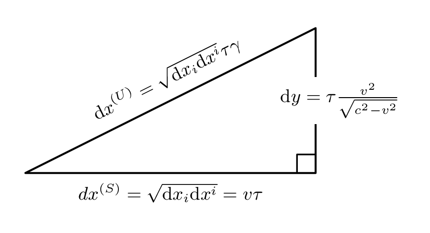

# The Lorentz Factor as the Slope of an Additional Spatial Coordinate: Embedding, Painlevè-Gullstrand Flow, and the Issue Of Simultaneity

Classically synchronized general relativity via an unwrapped Kaluza-Klein dimension where

$$
\gamma = \sqrt{1 - \left(\partial_x y\right)^2}
$$

due to

and $i = 1, 2, 3$
